# PetrutzCraft

A small Minecraft-style survival game for the desktop, written in C++20 with OpenGL 3.3.
It runs on Windows (the main target) and Linux.


## Features

- **Title screen and worlds**: Beta-style gray buttons on a dark dirt background, all drawn by the code. Singleplayer lists your worlds (newest first) and lets you create, rename and delete them. A new world takes a name and an optional seed: a number is used as is, any other text is turned into a number, and a blank seed picks a random one.
- **Saving**: worlds are saved every 60 seconds, when you open the pause menu and when you quit. Blocks you changed, where you stand, health, hunger, your whole inventory and armor, your bed, the weather, animals (sheared, saddled, dyed and tamed ones too), monsters and dropped items all come back when you load the world.
- **Endless Beta-style terrain** from 3D Perlin noise: rolling hills, steep cliffs with overhangs, the odd floating island, oceans with sand and gravel beaches. The world is 128 blocks tall with the sea at height 64. Chunks are generated (or loaded from the save) and meshed on background threads as you walk, so the game doesn't stutter.
- **Biomes** picked from temperature and rainfall like Beta: Rainforest, Swamp, Seasonal Forest, Forest, Savanna, Shrubland, Taiga, Desert, Plains, Ice Desert and Tundra. Grass and leaves change colour with the climate, deserts are sand with sandstone underneath, and water freezes over in Taiga, Tundra and Ice Desert. F3 shows the biome you are in.

  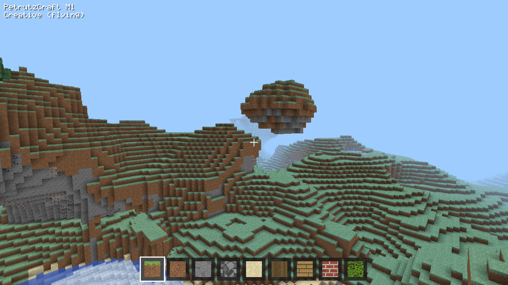

  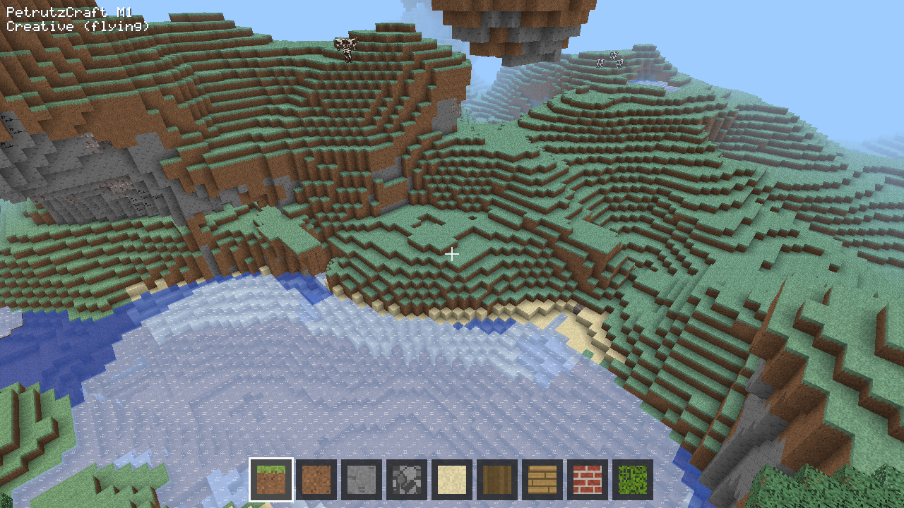
- **Trees by biome**: oaks, big oaks with branches, birches in forests, spruces and tall pines in the taiga. Deserts, plains and tundra have hardly any trees.
- **Underground**: winding caves and round cave rooms (filled with lava near the bottom), water and lava lakes underground and on the surface, pockets of dirt and gravel, clay under shallow water, and ores at Beta's depths: coal anywhere, iron below 64, gold and lapis lazuli below 32, redstone and diamond below 16.
- **Dungeons**: small mossy cobblestone rooms around a monster spawner, hidden where caves meet. The spawner (with a little monster spinning inside) makes zombies, skeletons or spiders while you are within 16 blocks, and the loot chests come once chests exist.
- **Ores drop Beta's items**: coal, diamonds, 4–5 redstone, 4–8 lapis lazuli, and clay blocks give 4 clay. Iron and gold ore drop themselves, ready for smelting (M7).
- **Building**: hold the left mouse button to mine a block. The block drops as an item that you pick up by walking over it. Right click places the selected block.
- **Tools** like Beta 1.7.3: pickaxes, axes, shovels, hoes and swords in wood, stone, iron, gold and diamond. Mining takes Beta's time: 1.5 s per point of the block's hardness by hand (a log takes 3 s, dirt 0.75 s), divided by the tool's speed on the blocks it is made for (wood 2, stone 4, iron 6, diamond 8, gold 12): pickaxes for stone, cobblestone, sandstone and ores, axes for logs, planks and chests, shovels for grass, dirt, sand, gravel and clay. Mining is five times slower with your head under water and again while you are in the air.
- **The right tool**: stone, cobblestone, bricks, sandstone, furnaces and ores drop nothing unless mined with a pickaxe, and take 5 s per point of hardness without one. Iron and lapis ore need a stone pickaxe or better; gold, diamond and redstone ore need iron or better.
- **Wear**: tools have Beta's durability (wood 59 uses, stone 131, iron 250, gold 32, diamond 1561) and break when they run out. Digging uses up one use of a tool (two of a sword); hitting uses one of a sword and two of a tool.
- **Weapons**: a fist hits for half a heart, swords for 2, 3, 4 and 5 hearts (wood and gold, stone, iron, diamond). Axes, pickaxes and shovels are weak weapons, between a fist and a sword (a diamond axe does 3 hearts).
- **Bow and arrows**: right click with a bow fires an arrow at once, as in Beta (no drawing back), using one arrow from your inventory. Arrows fly in an arc, hit animals and monsters for 2 hearts, and stick in the block they hit; walk over a stuck arrow to pick it up. They vanish after a minute.

  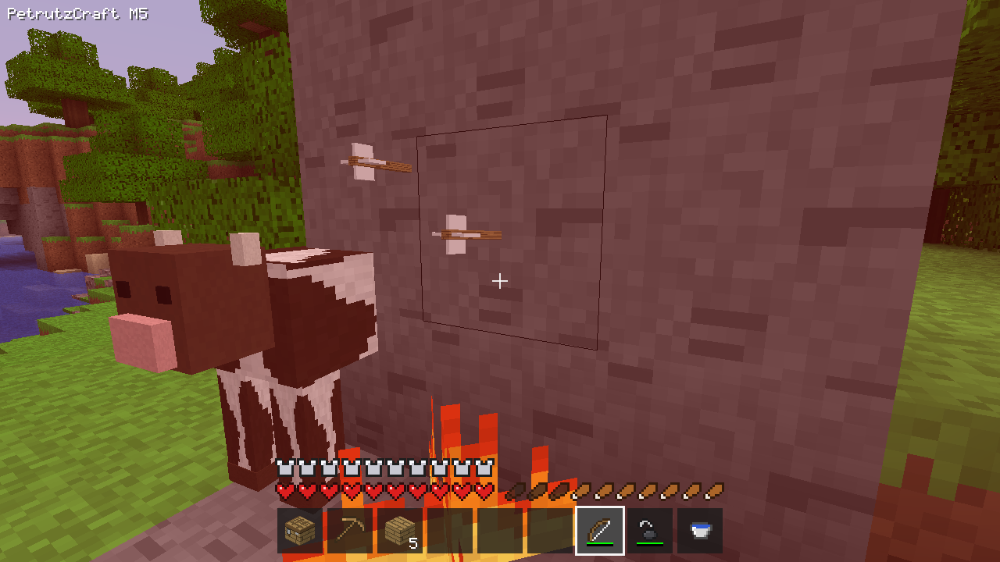

- **Armor**: leather, chain, iron, gold and diamond helmets, chestplates, leggings and boots. As in Beta every material gives the same protection (a full set is the whole armor bar and takes 80% off damage, 4% per point) and better materials last longer. Armor wears down with every hit, protects less as it wears, and breaks when worn out. It also softens falls. The armor bar shows above the hearts while you wear armor, and you can see it on your character in third person and in the inventory.

  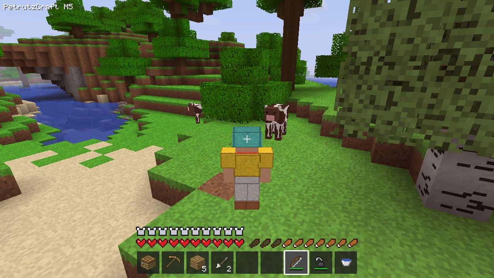

- **Flint and steel** lights a fire on top of a block, or next to anything that burns.
- **Buckets**: an empty bucket scoops up a water or lava source (it looks straight through flowing water, like Beta), a full one pours a source out again, and it flows from there. Right-click a cow with an empty bucket to milk it; drinking milk just gives the bucket back, as in Beta.
- **Shears** cut leaves quickly and keep them as leaf blocks.
- **Flowing water and lava** work like Beta 1.7.3. Water spreads 7 blocks from a source on flat ground and lava 3 (and much more slowly), each step a little lower, and both pour over edges and down holes, taking the shortest way to the nearest drop. Two water sources next to an empty block make a new source, so a 2x2 pool never runs dry. The surface slopes down the way the water runs. Water washes torches away. Where flowing lava meets water it turns to cobblestone, a lava source turns to **obsidian** (it needs a diamond pickaxe), and lava pouring onto water makes stone. Generated lakes and seas stand still until something next to them changes.
- **Currents** carry you, animals, monsters and dropped items along the way the water flows. Lava slows you down even more than water, and you can swim up in it, slowly.
- **Drowning**: with your head under water you have 15 seconds of air, shown as bubbles above the hunger bar; then you lose a heart every second until you come up.
- **Lava** burns you for 2 hearts at a time and sets you on fire for 30 seconds; standing in fire also sets you alight. Burning hurts half a heart a second and shows flames over the screen. Water and rain put you out. Items that fall in lava or fire burn up.
- **Falling sand and gravel**: sand and gravel fall when the block under them goes, and land as blocks again (or drop as an item if they land on a torch). Gravel drops flint 1 time in 10.
- **Fire** spreads like Beta's: it burns up planks, logs, leaves and TNT (setting it off), jumps across gaps and climbs upwards, and burns out on bare stone. Lava lights fires in the air next to wood or leaves above it. Rain puts fires out, and on Normal and Hard lightning starts fires where it strikes.

  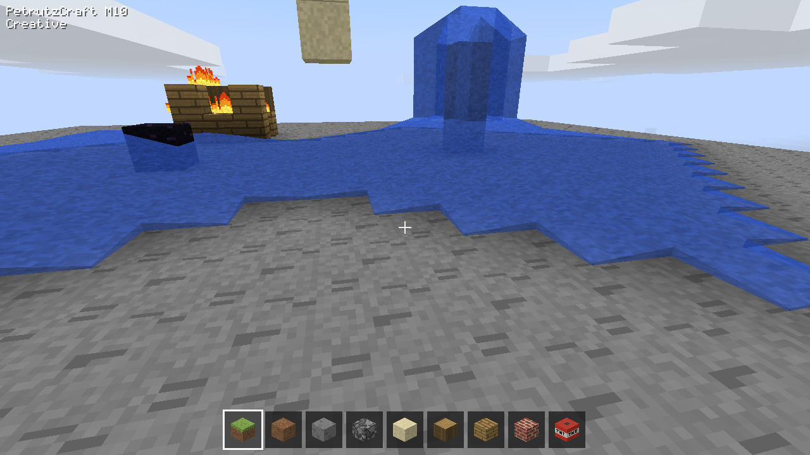

- **Leaves decay** like Beta's: chop down a tree's trunk and the leaves more than 4 leaves away from any other log fall away over the next minutes. Leaves you place yourself never decay. Leaves (broken or decaying) drop a **sapling** 1 time in 20, and oak leaves an apple now and then.
- **Saplings** (oak, birch and spruce) go on grass or dirt and grow into their tree in light 9 or more, after about 20 minutes on average; an oak sapling sometimes makes a big oak. Bone meal grows one at once. A sapling with no room above it waits.
- **Snow and ice**: cold biomes are covered in a thin layer of snow (grass under it turns white at the sides), and while it snows more settles and still water freezes over. Snow layers are walked through, and a shovel (or anything) breaks one into a snowball. Ice and snow melt next to bright light like torches, glowstone or lava, but not in daylight; broken ice turns into water.
- **Cactus** grows in deserts, on sand, up to 3 tall. Nothing solid can stand next to it: it breaks off (and drops) if you build against it. It hurts half a heart when you, a mob or a cow touches it, standing on it included, and it destroys dropped items.
- **Cobwebs** slow anything in them to a crawl and stop a fall. Swords and shears cut them quickly; they drop string. Like Beta 1.7.3, the world doesn't make any, so they come from the creative item picker.

  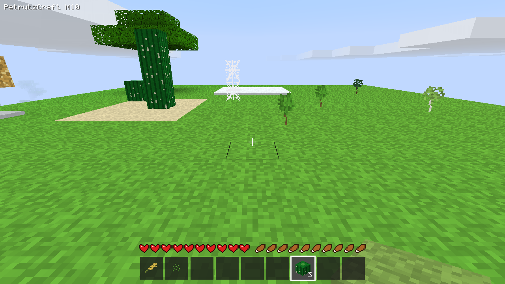

- **Health and hunger**: you have 10 hearts and 10 drumsticks. Walking, sprinting, jumping, mining and fighting use up hunger. When you are well fed you slowly heal. When you are starving you slowly lose health, down to half a heart. Falls of more than 3 blocks hurt, and a big enough fall kills you.
- **Animals** like Beta 1.7.3, with original blocky models. They wander, graze and hop up ledges; punch one and it panics and runs away. Animals caught in fire or lava burn, and burning pigs and cows drop their meat cooked.
  - **Cows** drop 1 to 3 beef and up to 2 leather. Right-click one with an empty bucket to milk it.
  - **Pigs** drop up to 2 raw porkchops. Right-click a pig with a saddle to saddle it, then right-click it again to ride. As in Beta you can't steer: the pig goes where it likes. Sneak to get off. A saddled pig drops its saddle when it dies.
  - **Sheep** grow white wool mostly, sometimes grey, light grey, black or brown, and very rarely pink. Shears take 1 to 3 wool off (it doesn't grow back, as in Beta), and a sheep with its wool drops one wool when it dies. Right-click a sheep with any dye to colour its wool.
  - **Chickens** flutter down slowly instead of falling, lay an egg every 5 to 10 minutes and drop up to 2 feathers. Right-click with an egg to throw it: one egg in 8 hatches a chicken, and now and then four.
  - **Squid** swim about in the sea and drop 1 to 3 ink sacs.
  - **Wolves** live in forests and taiga. Hit one and it turns on you, with the rest of its pack. Wild wolves now and then hunt sheep. Right-click a wolf with bones to tame it (one bone in three works): it sits down, and right-clicking it again makes it stand and follow you, or sit and wait. A tamed wolf jumps to you when you get far away, attacks whatever you hit or whatever hits you, shows its health by how high it holds its tail, and eats porkchops and beef to heal.
  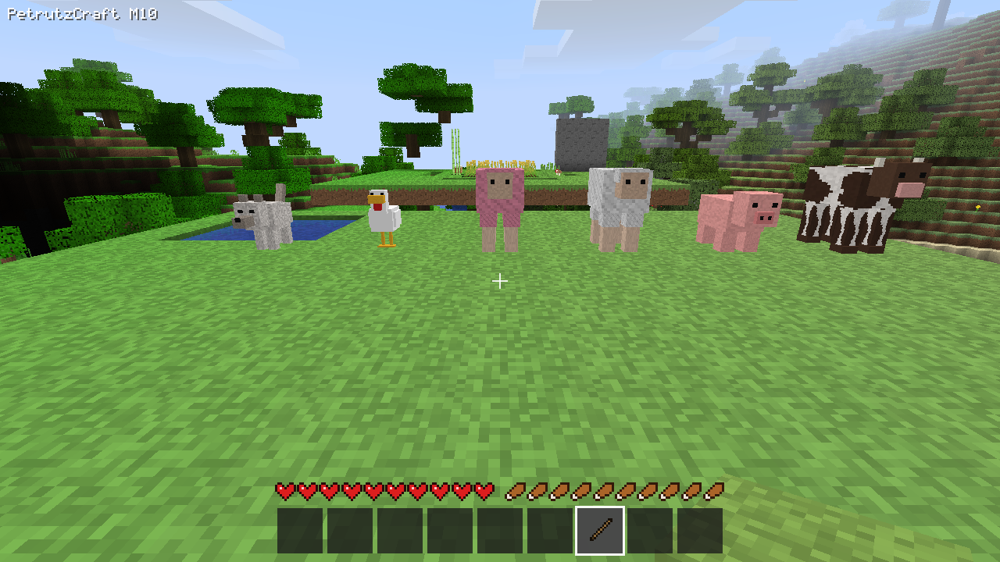
- **Spawning**: animals mostly appear as the world is made, in groups of up to 4 on grass, picked by the biome (Beta's weights: sheep, then pigs and chickens, then cows; wolves in forests and taiga; none in the desert), with squid in the sea. A few more turn up out of sight as you explore. Unlike Beta, animals never despawn.
- **Farming** like Beta 1.7.3: right-click grass or dirt with a **hoe** to make farmland. Farmland within 4 blocks of water (or out in the rain) turns dark and wet; dry farmland with nothing planted turns back to dirt. **Seeds** (one in eight bits of tall grass drops one) plant wheat, which grows through 8 stages in light 9 or more, fastest on wet farmland with more farmland around it and slower when crops crowd it on two sides. In the best spot it ripens in about 25 minutes of daylight. Ripe wheat drops wheat and 0 to 3 seeds; three wheat in a row make **bread**. Jumping or falling onto farmland can trample it back to dirt; walking over it is safe.
- **Bone meal** (from bones) ripens a crop or grows a sapling into a tree at once, or sprouts tall grass and flowers around the grass you use it on.
- **Wild plants**: tall grass (on plains and in forests), ferns (in rainforests), dandelions, roses, brown and red mushrooms (in dark places, where they slowly spread) and **sugar cane** by water, which grows up to 3 tall. Plants pop off when the block under them goes. Sugar cane makes sugar and paper; the mushrooms make mushroom stew.
- **Food**: apples, golden apples, bread, mushroom stew (gives back the bowl), raw and cooked porkchops, raw and cooked fish, cookies, beef and **cake**. Each fills hunger and saturation (Minecraft 1.0's values, since hunger is kept). A cake is placed as a block and eaten a slice at a time with a right click: six slices of 1 drumstick each.

  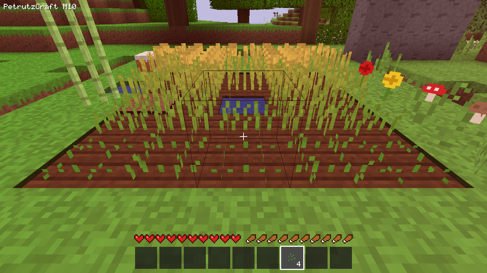
- **Building** like Beta 1.7.3:
  - **New blocks**: wool in 16 colours (dye white wool with any of the 16 dyes), gold, iron, diamond and lapis blocks, bookshelves, snow and clay blocks, netherrack and soul sand (it slows you down), plus glass, sandstone, mossy cobblestone, obsidian and ice.
  - **Shapes**: stone, sandstone, wooden and cobblestone **slabs** (two of a kind stack into a double slab), wooden and cobblestone **stairs**, **fences** (1.5 blocks high to jump, joining the fences beside them), **ladders** (climb by walking into them; sneak to hold on), wooden and iron **doors**, and **trapdoors**. You walk up slabs and stairs without jumping, and you bump into each shape as it looks.
  - **Doors** open with a right click, both halves at once; iron doors wait for redstone. Trapdoors flip open the same way.
  - **Chests**: right-click to open. Two side by side join into a double chest with 54 slots; three in a row won't go. Shift-click moves stacks in and out. Breaking a chest spills what is in it. Dungeons now have one or two chests with Beta's loot.
  - **Signs** on the ground or on a wall: placing one opens a screen to type four lines of text, which shows on the sign.
  - **Paintings**: hang one on a wall and it picks a random picture that fits there, from 1x1 up to 4x4 blocks. The 15 pictures are this game's own.
  - **Note blocks** play a note when hit or right-clicked; each right click goes a semitone up over two octaves. The block under it picks the instrument: stone a bass drum, sand a snare, glass clicks, wood a bass, anything else a harp.
  - **Jukebox**: put in a music disc (found in dungeon chests) to play it, right-click again to take it out. The two discs, "13" and "cat", play this game's own tunes.
  - Ladders, signs, paintings, doors and trapdoors fall off when the block holding them goes. Everything here is saved with the world.

  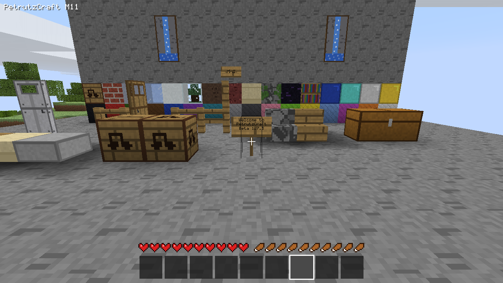
  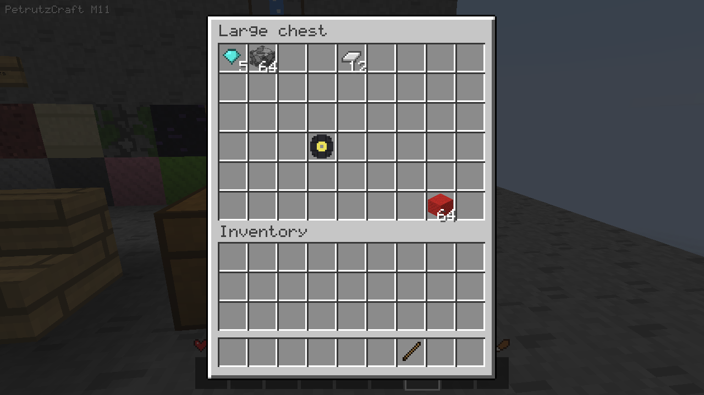
  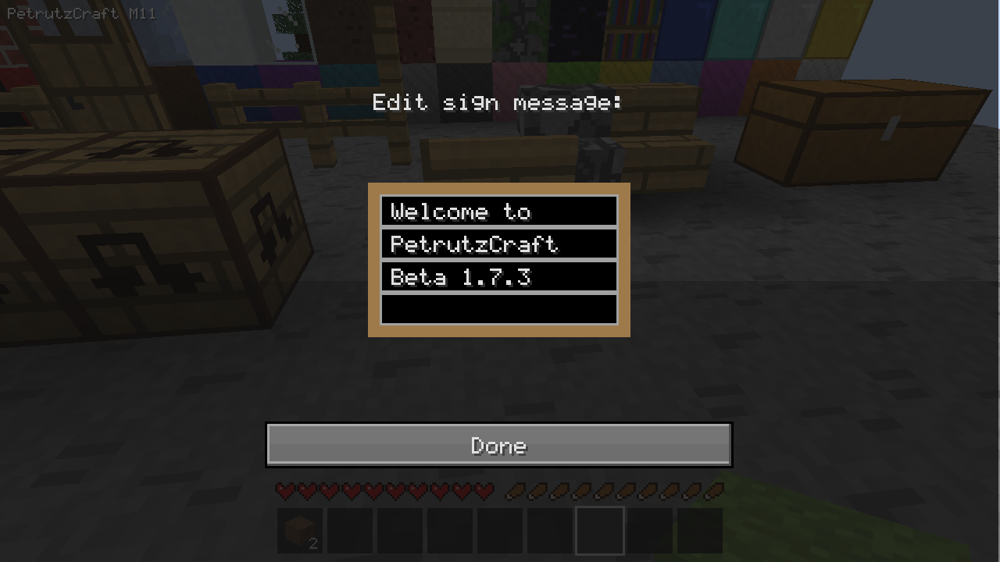
- **Monsters** like Beta 1.7.3, with original blocky models:
  - **Zombies** walk at you and hit for 2.5 hearts, and drop feathers.
  - **Skeletons** keep their distance and shoot arrows; they drop arrows and bones.
  - **Creepers** walk up to you, hiss, swell and flash white for a second and a half, then explode (step back to stop them). They drop gunpowder, unless they blew up. Lightning makes a charged creeper with a blue glow and twice the blast.
  - **Spiders** climb walls and leap at you, but leave you alone in daylight unless you hit them. They drop string. One spider in a hundred carries a skeleton (a spider jockey).
  - **Slimes** hop about deep underground (below height 16 in one chunk in ten). Big ones split into 2 to 4 smaller ones when they die; the smallest are harmless and drop slimeballs.
- **Spawning**: monsters appear in the dark (light 7 or less) at least 24 blocks from you, up to Beta's cap. They vanish when you go more than 128 blocks away, and now and then when you stay away. Zombies and skeletons catch fire in sunlight unless they are in the shade or in water. You can't sleep with monsters close by.

  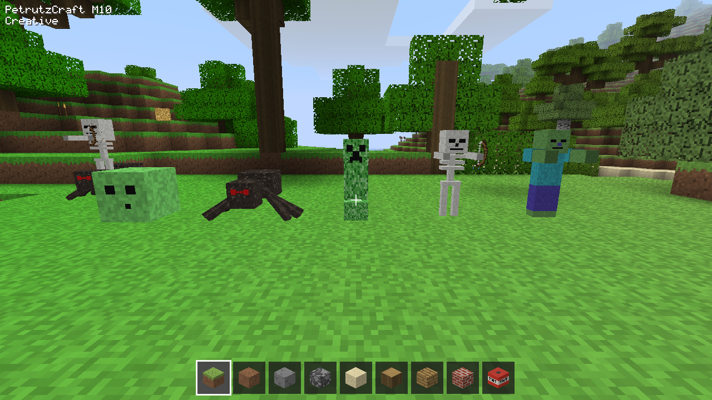
- **Combat**: hits knock you and monsters back, a red flash shows the hurt, and for half a second after a hit only a harder hit does anything (just the difference). Dying monsters tip over, turn red and vanish in a puff of smoke, dropping their items.
- **Explosions**: creepers and **TNT** blast holes in the ground, hurting and throwing everything nearby (less behind walls). Stone holds out better than dirt, and water, lava and bedrock stop a blast. Breaking TNT or using flint and steel on it lights it: it flashes for 4 seconds and blows up, and a blast lights other TNT nearby. 30% of the blocks a blast destroys drop.
- **Sound effects**: the creeper's and lit TNT's hiss and the boom of a blast, made by the code (no sound files). They fade with distance (a blast carries 64 blocks, a hiss 16) and come from the side they are on. Without speakers or an audio device the game simply runs silent. The rest of the sounds and music come in M16.

  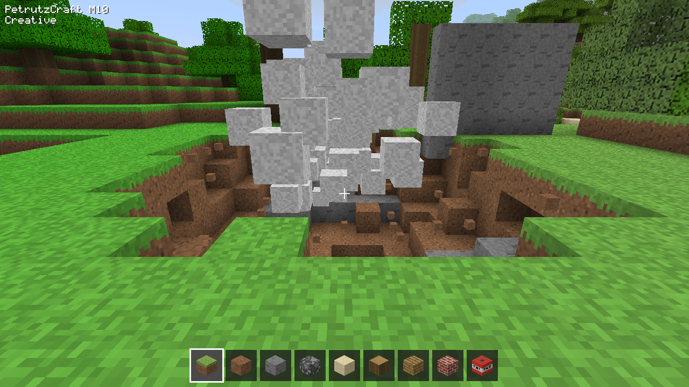
- **Difficulty** (in Options): Peaceful (no monsters; health comes back by itself and hunger stays put), Easy (monsters do a third of their damage plus half a heart), Normal (the default) and Hard (half as much again).
- **Death**: when you die a "Game over!" screen offers Respawn or Title menu. Your whole inventory and armor drop where you died, and you come back by your bed, or at the world spawn.

  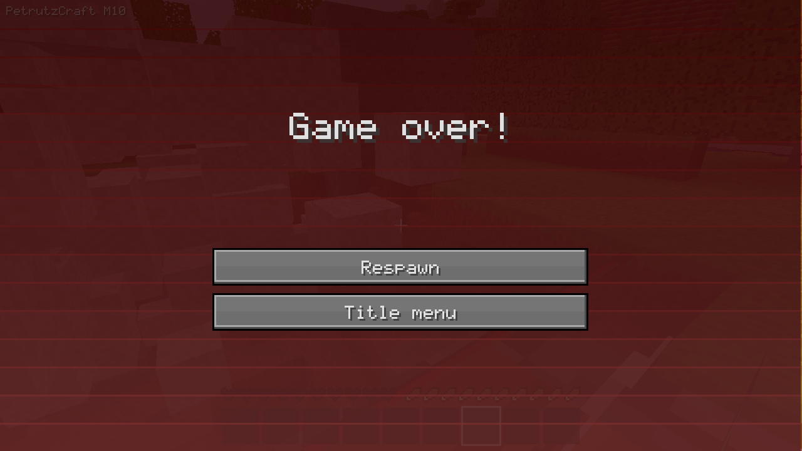
- **Inventory and crafting** like Beta 1.7.3: press E for 27 storage slots, the 9-slot hotbar, 4 armor slots and a 2x2 crafting grid, with your character turning to look at the mouse. Place a **crafting table** and right-click it for the 3x3 grid. Every Beta recipe is there (tools, weapons, armor, doors, stairs, slabs, fences, ladders, signs, beds, boats, rails, dyes, wool and the rest), as a table in the code. Shaped recipes work anywhere in the grid and mirrored.

  
  
- **Stacks**: most items stack to 64; snowballs, eggs, signs and empty buckets to 16; tools, armor, cake and mushroom stew don't stack. Food stacks to 64 because hunger is kept. Tools and armor have Beta's durability, shown as a bar once they are worn.
- Every Beta item exists with an icon drawn by the code (blocks show as little 3D cubes). Items whose use comes in a later milestone (tools mining faster, torches, doors, wool...) can be crafted and carried but not used or placed yet. The crafting table, chest and furnace can be placed; chests open in a later milestone.
- **Furnaces** like Beta 1.7.3: place one (its front faces you) and right-click it. Put something to smelt in the top slot and fuel in the bottom one; the flame shows how much fuel is left and the arrow how far the item is cooked (10 seconds each). A burning furnace lights up and gives off light 13, and keeps smelting when you close it or walk away, as long as it is within your render distance (further away it waits, like Beta). Breaking it drops what is inside. Its contents are saved with the world.
  - Smelting: iron ore to iron ingots, gold ore to gold ingots, diamond ore to diamonds, sand to glass, cobblestone to stone, clay to bricks, any log to charcoal, raw porkchop and fish to cooked, cactus to cactus green, and beef to **steak** (not in Beta, which had no beef; steak fills 8 hunger like a cooked porkchop).
  - Fuel: coal and charcoal (80 s, 8 items), logs, planks and other wooden blocks (15 s), sticks and saplings (5 s), and a lava bucket (1000 s, and the empty bucket stays in the fuel slot, unlike Beta which lost it).
- **Glass** comes out of a furnace and can be placed. It is see-through and breaks into nothing, like Beta.

  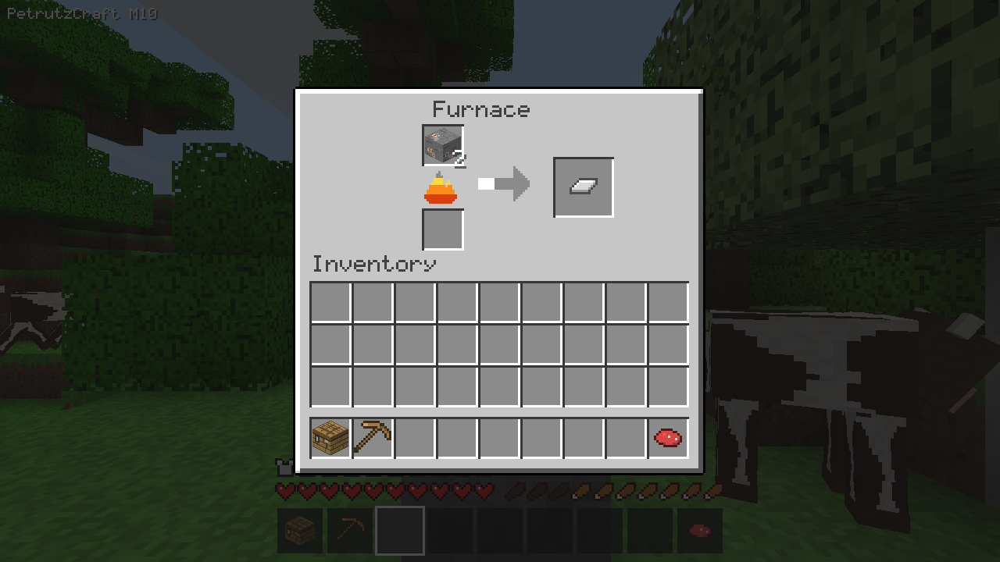
  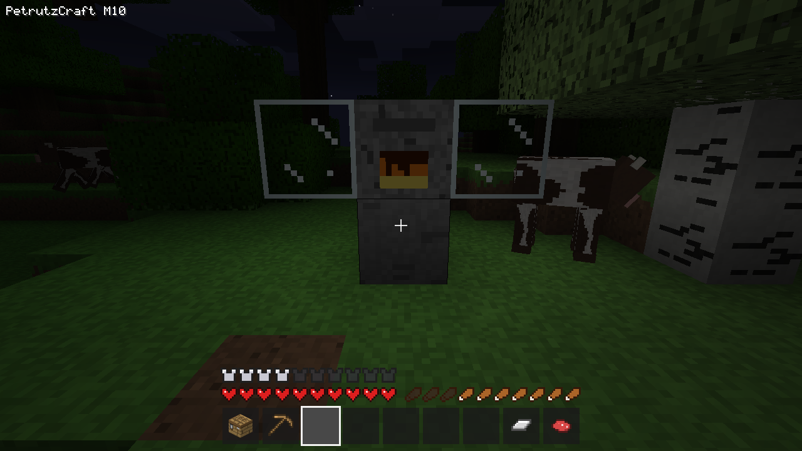
- **Creative mode** (a cheat key) gives you unlimited blocks, instant mining and flying. E opens an item picker with every item: click one to hold a full stack, Shift-click to put it straight in the hotbar, scroll with the mouse wheel.

  
- **Sneaking** (Shift) makes you slower and stops you from walking off edges. **Sprinting**: double-tap W and keep holding it.
- **Your hand** in first person: an empty hand shows your arm, and the item selected in the hotbar is held in it in 3D, like Beta: blocks as little cubes (slabs and stairs in their shape), tools and other items as their icon one pixel thick. The hand swings when you hit something (or nothing), while you mine, and when a right click places a block or uses something on one. Eating and the bow don't swing it. When you pick another hotbar slot the hand dips out of view and comes back up with the new item, and while you walk the view and the hand bob gently, as in Beta (View Bobbing in Video Settings turns that off). Every item gets its held model from its icon, so new items show up in the hand by themselves.

  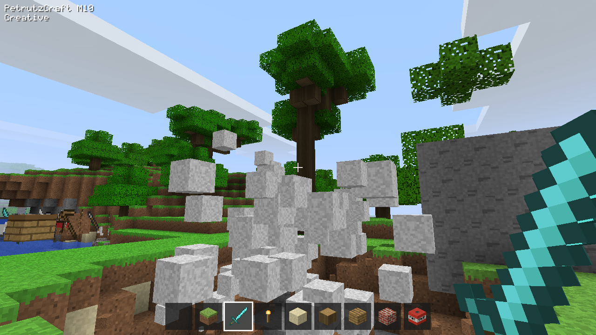
  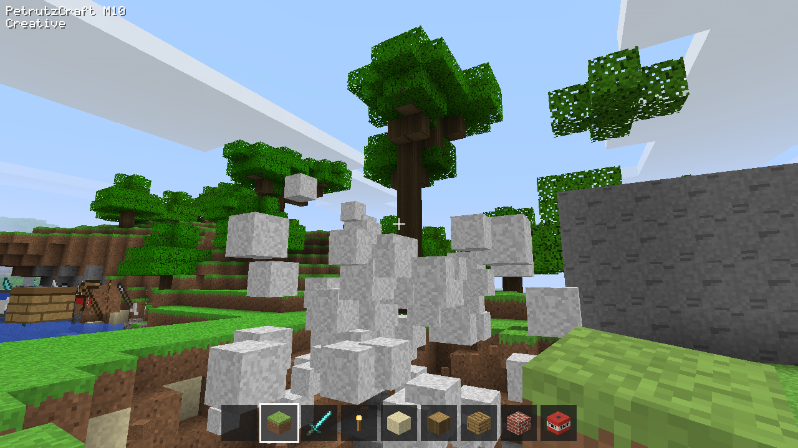
- **Third-person view** (F5) shows your character: an original blocky figure with a red shirt and jeans.

  
- **Light**: every block has a sky light and a block light level from 0 to 15, like Beta. Sky light pours straight down from the open sky and spreads sideways one level less per block, so caves, overhangs and the ground under a roof get darker. Leaves dim it by 1 and water by 3 per block. Light is worked out again around every block you place or break.
- **Torches and glowstone** give off light (14 and 15). Torches stand on top of a block or hang on its side, and fall off when that block is broken. Craft 4 torches from coal or charcoal above a stick, or take torches and glowstone from the creative item picker.
- **Day and night**: a day lasts 20 minutes and a new world starts in the morning. The sun rises in the east and sets in the west with an orange glow, then the moon and stars come out. The sky and fog darken and the world gets dark at night (sky light drops by 11 levels), so torches matter.

  

  
- **Weather** like Beta: rain comes and goes on random timers (it rains for 10 to 20 minutes, then stays dry for 10 to 150), and fades in and out over 5 seconds. Rain greys and darkens the sky and hides the sun, moon and stars. Cold biomes (Taiga, Tundra, Ice Desert) get snow instead, and deserts stay dry. Rain and snow stop at roofs and leaves, so you can shelter under them. Thunderstorms darken the sky further, and lightning strikes rained-on ground, flashing the sky and doing 2.5 hearts of damage to anything within 3 blocks.

  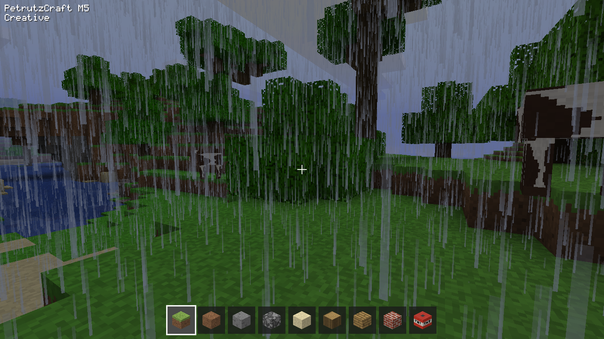

  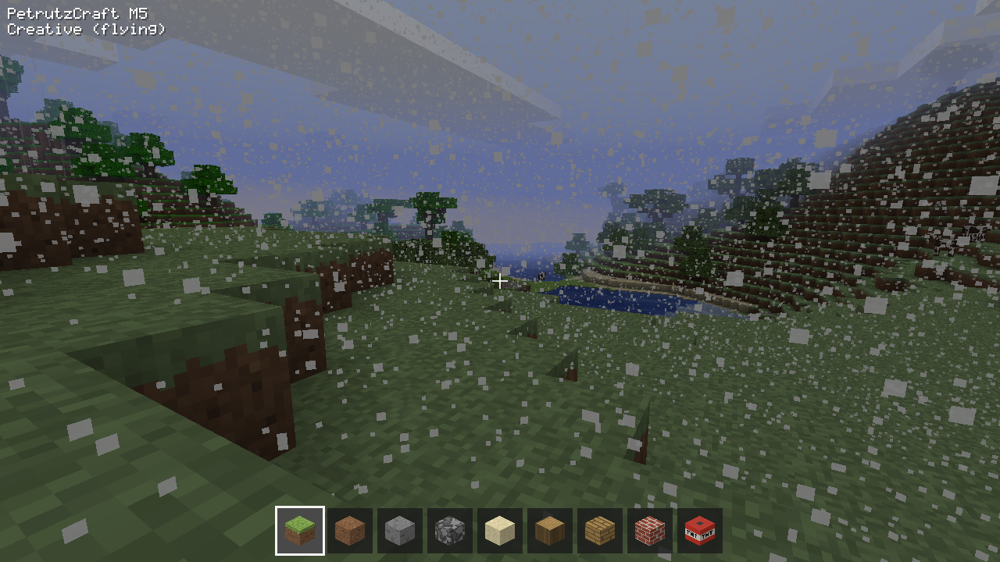

  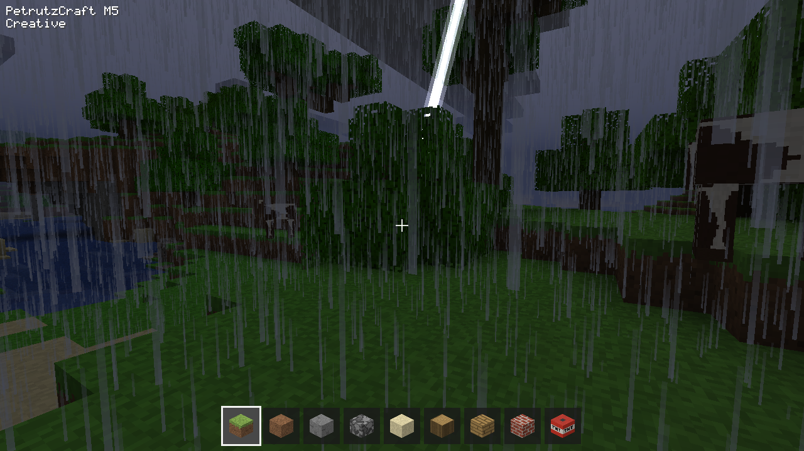
- **Beds**: craft one from 3 wool over 3 planks and right-click the top of a block to place it (the head points the way you face). Right-click the bed at night, or in a thunderstorm, to lie down; after 5 seconds the night is skipped, the morning is clear and the bed becomes your spawn point. If the bed is broken or walled in, you respawn at the world spawn instead ("Your home bed was missing or obstructed"). Breaking either half removes the whole bed and drops it.

  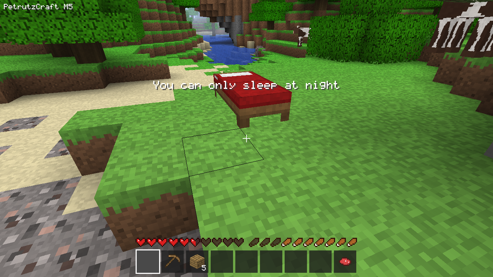
- **Rails and minecarts**: rails join up with the rails next to them, turn corners and climb one block, as in Beta. Ride a minecart (right-click it, Shift to get out): it rolls downhill, keeps going on the flat and slows down over time. Powered rails speed carts up (they are always on until redstone arrives in M13; unpowered they would brake), and detector rails switch on while a cart is on them. A storage minecart holds 27 stacks (right-click to open it), and a powered minecart burns coal or charcoal to push itself along, away from you.

  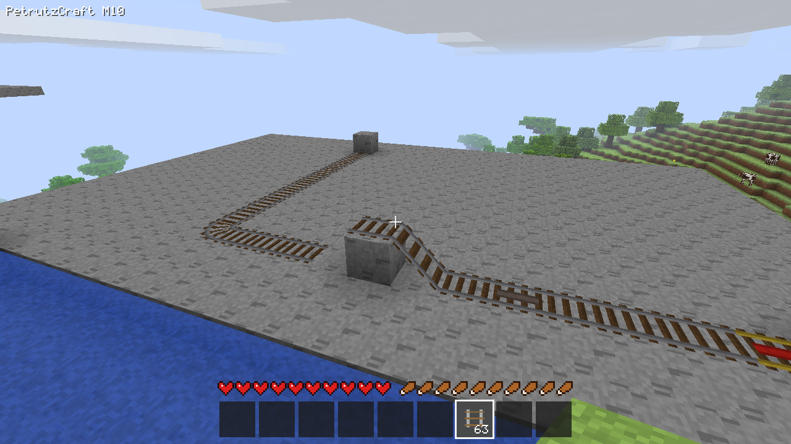

  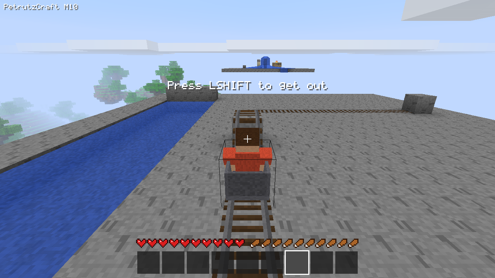
- **Boats** float on water and steer with W A S D the way you look. A boat that hits something too fast breaks into 3 planks and 2 sticks (so does one you punch, like Beta).

  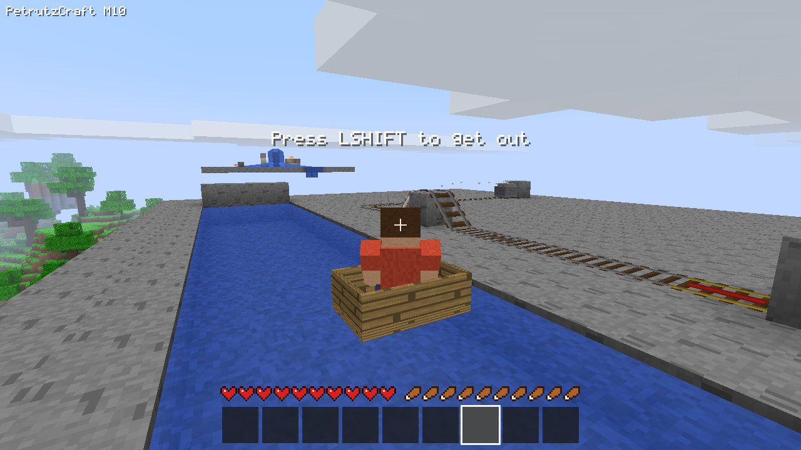
- **Compass and clock**: the compass needle points to the world spawn and swings round as you turn, wobbling a little before it settles, like Beta's. The clock's dial turns once a day, with the sun at the top at noon and the moon at midnight. Both move in the hotbar, the inventory and your hand.
- **Maps**: craft one from eight paper around a compass. Holding a new map starts it: it gets a number and is centred where you stand, a pixel for every 8 by 8 blocks (1024 blocks across, Beta's scale), and fills in the land within 128 blocks of you while you hold it, with Beta's colours and shading for hills and deep water. Held, it shows in front of you with a white arrow for where you are and the way you face. Maps are saved in the world's `data` folder.

  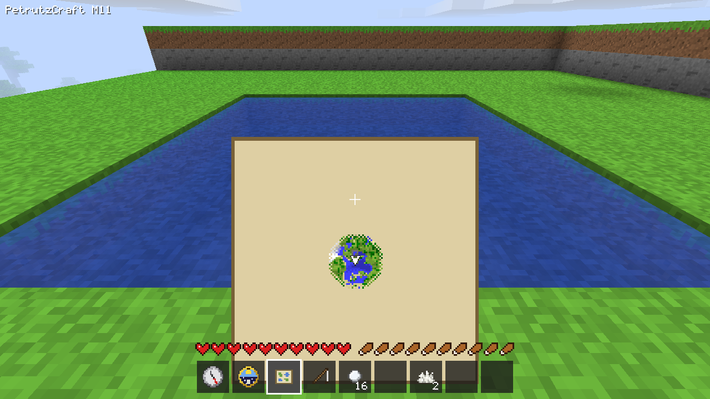
- **Fishing**: right-click with a fishing rod to cast the bobber, right-click again to reel it in. A fish bites now and then (more often in the rain): the bobber dips and splashes, and reeling in right then lands a raw fish at your feet. Casting at an animal or monster hooks it and reeling in pulls it towards you. The rod wears by 1 for a fish, 2 for pulling the bobber off the ground and 3 for pulling a mob, like Beta.

  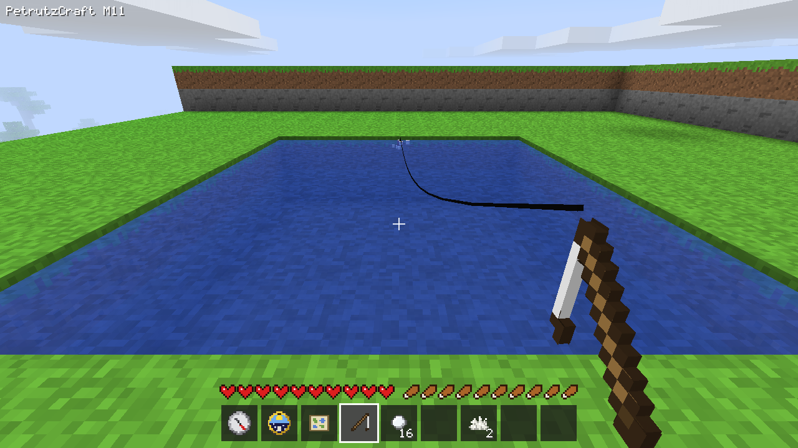
- **Snowballs** (from snow, with a shovel) can be thrown with a right click; they break where they land.
- **Clouds** drift slowly over the world at height 108: 3D boxes with Fancy graphics, a flat layer with Fast graphics. They can be turned off in Video Settings.
- **Debug screen** (F3) with your position, chunk, facing, biome, light level (sky and block), time of day, weather, seed and frame rate. F1 hides the HUD and F2 saves a screenshot.
- All textures and the font are drawn by the code itself (no image files), with smooth lighting (ambient occlusion plus light levels blended across each face) and distance fog.

## Build and run on Windows

You need a graphics card with OpenGL 3.3, which almost every computer from the last ten years has.

1. Install **Visual Studio 2022 Build Tools** from <https://visualstudio.microsoft.com/downloads/> (under "Tools for Visual Studio"). In the installer, tick the **Desktop development with C++** workload. It includes the compiler, the Windows SDK and CMake.
2. Install **VS Code** and, from its Extensions panel, the **C/C++** and **CMake Tools** extensions (both by Microsoft).
3. Open this folder in VS Code (File > Open Folder).
4. When CMake Tools asks for a kit, pick **Visual Studio Build Tools 2022 Release - amd64**. (Later you can change it with the command palette: *CMake: Select a Kit*.)
5. In the status bar, set the build variant to **Release**, then click **Build** (or press F7). The first build downloads GLFW, GLM, doctest and miniaudio, which takes a minute.
6. Click the ▷ button in the status bar (or *CMake: Run Without Debugging*, Shift+F5) to play. The program is `build/PetrutzCraft.exe` (or `build/Release/PetrutzCraft.exe`, depending on the generator).

From a terminal instead, open **Developer PowerShell for VS 2022** in this folder and run:

```powershell
cmake -S . -B build
cmake --build build --config Release
.\build\Release\PetrutzCraft.exe
```

Every push also builds `PetrutzCraft.exe` on GitHub: open the latest run under the **Actions** tab and download the **PetrutzCraft-windows-x64** artifact.

## Build and run on Linux

```bash
sudo apt install build-essential cmake ninja-build libxrandr-dev libxinerama-dev libxcursor-dev libxi-dev libgl-dev
cmake -S . -B build -G Ninja -DCMAKE_BUILD_TYPE=Release
cmake --build build
./build/PetrutzCraft
```

## Where your worlds and settings are kept

Everything lives in the folder the program is in (for example `build\Release\`):

| Path | What it is |
| --- | --- |
| `saves/<world>/level.json` | The world's name, seed, play time, spawn point and the player (position, health, hunger, inventory slots 0-35 and armor slots 100-103 like Beta) |
| `saves/<world>/region/r.X.Z.pcr` | The world's chunks, 32 x 32 chunks per file, each one compressed. Animals, monsters and dropped items are stored with the chunk they are in |
| `options.txt` | Your settings, one `name:value` per line like Beta's |
| `screenshots/` | Pictures taken with F2 |

Deleting the `build` folder deletes these too, so copy `saves/` somewhere safe first.

## Options

The **Options** button on the title screen (or in the pause menu) has:

- **Invert Mouse**, mouse **Sensitivity** and **Difficulty** (Peaceful, Easy, Normal or Hard). Music and Sound volume come with the rest of the sounds (M16).
- **Video Settings**: **Graphics** Fancy (see-through leaves, 3D clouds) or Fast (solid leaves, flat clouds), **Render Distance** Far (16 chunks), Normal (8, the default), Short (4) or Tiny (2), **Smooth Lighting** on or off, and **Clouds** on or off.
- **Controls**: click a key, then press the new key for it. A key used twice turns red.

Command line:

```bash
PetrutzCraft --seed 42      # fills in the seed when you create a new world
PetrutzCraft --fullscreen
```

## Controls

These are the defaults. Every key except the F keys, Esc, H and 1–9 can be changed under Options > Controls.

| Key | Action |
| --- | --- |
| Mouse | Look around |
| W A S D | Move |
| Space | Jump, or swim up in water or lava |
| Left Shift | Sneak: walk slowly without falling off edges |
| Double-tap W (and hold) | Sprint (not possible when hunger is 3 drumsticks or less; stops when you let go, sneak or hit a wall) |
| Left mouse (hold) | Mine a block, or hit an animal or monster (with the selected tool or weapon) |
| Right mouse | Place the selected block (a torch goes on the top or side of the block you point at, a bed on top), eat the selected food, shoot the bow, light a fire or TNT with flint and steel, or fill, pour and drink from a bucket |
| Right mouse on a bed | Sleep (at night or in a thunderstorm) |
| Right mouse on an animal | Milk a cow (bucket), saddle or ride a pig, shear or dye a sheep, tame a wolf (bone), feed a tamed wolf (meat), or make a tamed wolf sit or follow |
| Left Shift while riding | Get off the pig, or out of a minecart or boat |
| 1–9 / mouse wheel | Choose a hotbar slot |
| Q | Drop one of the selected item |
| E | Open or close the inventory (the item picker in creative) |
| Right mouse on a crafting table | Open the 3x3 crafting grid |
| Right mouse on a furnace | Open the furnace |
| Right mouse on a chest | Open the chest (a block on top keeps it shut) |
| Right mouse on a door or trapdoor | Open or shut it |
| Right mouse / left mouse on a note block | Raise its note / play it |
| Right mouse on a jukebox | Put in the held music disc, or take the disc out |
| Right mouse on a minecart or boat | Get in (Left Shift gets out) |
| Right mouse on a storage minecart | Open its chest (shift-click moves stacks between it and your inventory) |
| Right mouse on a powered minecart with coal | Fuel it: it pushes away from you |
| Right mouse with a fishing rod | Cast the bobber, or reel it in (with a fish if one is biting) |
| Right mouse with an egg or snowball | Throw it |
| C | Cheat: switch between survival and creative |
| Space twice (creative) | Toggle flying. While flying, Space goes up and Shift goes down |
| F1 | Hide or show the HUD |
| F2 | Save a screenshot to `screenshots/` |
| F3 | Debug screen |
| F5 | Third-person view |
| H | Show or hide the help text |
| Esc | Pause menu (Back to Game, Options, Save and Quit to Title). The world is saved when it opens |

In the inventory, crafting table and furnace screens (Beta's mouse rules):

| Mouse / key | Action |
| --- | --- |
| Left click | Pick up a whole stack, put the held stack down, add it to the same item, or swap with a different item |
| Right click | Pick up half a stack, or put down one item from the held stack |
| Shift + left click | Move a stack between the hotbar and the storage rows, or out of the crafting grid or a furnace slot. On the crafted item: craft as many as fit |
| Click outside the window | Throw the held stack (right click throws one) |
| Q over a slot | Throw one item from it |
| E or Esc | Close. Items left in the crafting grid or on the mouse go back into your inventory (and drop only if it's full) |

## Survival tips

- Click **Singleplayer**, then **Create New World**.
- Punch a tree (about 3 s per log), press **E** and put the logs in the crafting grid to make planks, then make a crafting table from 4 planks and build a shelter.
- Cows, pigs, sheep and chickens are found on grass. A herd of cows and a few other groups spawn near you at the start, and more appear as you explore. Tame a wolf with bones to fight beside you.
- Break tall grass for seeds, till the ground next to water with a hoe and plant them for bread.
- Make a wooden pickaxe (3 planks over 2 sticks) before mining stone: by hand stone is slow and drops nothing. A stone pickaxe gets you iron ore; a furnace (8 cobblestone in a ring) smelts it into ingots. Cook beef in the furnace too: steak fills more than twice as much as raw beef.
- Keep at least 9 drumsticks of hunger to regenerate health.
- Light up your home with torches before night: monsters spawn in the dark. Back away from a hissing creeper.
- Set the difficulty to Peaceful under Options if you just want to build.
- On fire? Jump in water. Dig carefully next to the sea or a lava lake: they pour into the hole you make.

## Tests

```bash
ctest --test-dir build --output-on-failure        # logic tests (add -C Release on Windows)
xvfb-run -a -s "-screen 0 1280x720x24" ./build/PetrutzCraft --seed 7 --autotest OUT_DIR
```

The second command plays a scripted game and saves screenshots plus `report.txt` to `OUT_DIR`: it opens the title and options screens, creates a world from the Create New World screen, finds a cow, kills it, picks up and eats the beef, mines and places a block, crafts planks and a crafting table in the inventory screen, puts on a chestplate, crafts a pickaxe on a placed crafting table, takes a stack from the creative item picker, falls, mines stone by hand and with a pickaxe, takes a hit in full armor, shoots arrows into a wall, lights a fire, pours and scoops up water, flies, visits a desert, hills, a taiga and a torch-lit cave (checking for sandstone, spruces, frozen water and every ore), takes F5 (in armor) and F3 pictures, places a torch and glowstone and checks their light, takes pictures at night and at sunset, makes it rain, snow and thunder (checking that lightning hurts), places a bed, sleeps through the night in it and respawns by it, fights every monster in a flat arena (a zombie's hit and knockback, a sword's hits and the invulnerability after them, a skeleton's arrow, a creeper's fuse and crater, a spider climbing a wall, a slime splitting, a zombie burning in the sun, a chain of TNT, a mob spawner, Peaceful, the death screen and natural spawning at midnight), builds a platform in the sky to try water falling off a pillar and spreading, lava turning to obsidian, sand and gravel falling, a plank hut burning, drowning, lava setting the player on fire, water putting them out, a current carrying them and lightning starting a fire, tills a field next to water, plants seeds, ripens wheat with bone meal and harvests it, eats a slice of cake, counts the wild plants and visits a meadow, builds a gallery of the new building blocks in the sky (hangs paintings, joins two chests and fills the double chest, places stairs, slabs and a double slab, a fence with a door, an iron door, ladders and a trapdoor, plays a note block, puts a disc in a jukebox and types on a sign, then breaks a door and a ladder's wall), builds a pen with every animal (saddles and rides the pig, shears and dyes sheep, milks the cow, tames a wolf that then follows the player and bites a zombie, angers a wild wolf, has a chicken lay an egg, throws eggs until chickens hatch, and checks the saddle and ink sac drops), lays a track with a slope, a curve, a powered rail and a detector rail and rides a minecart along it, fills a storage minecart, fuels a powered minecart, breaks a minecart, sails a boat and crashes it, turns a compass towards the spawn and watches the clock turn from noon to midnight, fills in a map around a pond, fishes in the pond until a fish bites and reels it in, pulls a bobber off the grass, hooks a pig and pulls it closer, throws a snowball, opens the pause menu, changes a block, saves and quits to the title, and loads the world again to check that everything came back (the map too). Its world and `options.txt` go in `OUT_DIR`, so your own saves are never touched. It exits with an error if any check fails. On Windows or a Linux desktop, run it without `xvfb-run`. GitHub runs both on every push (the screenshot test on Linux only, since GitHub's Windows machines have no graphics card).

## Project layout

```
CMakeLists.txt     build script; downloads GLFW, GLM, doctest and miniaudio
src/
  main.cpp         command-line options and the window
  app.cpp          the title screen, menus and options around the game, loading and quitting worlds
  menu.cpp         every menu screen (title, world list, create/rename/delete, options, controls, pause)
  ui.cpp           2D drawing: rectangles, icons and pixel text for the HUD and menus
  game.cpp         controls, mining/building, survival rules, animals, monsters, explosions, item drops and saving one world
  save.cpp         save files: level.json, region files, world folders, background saving
  options.cpp      options.txt and the key bindings
  json.cpp         a small JSON reader and writer
  zlib.cpp         zlib compression and decompression (for saves and PNG screenshots)
  world.cpp        chunk storage, meshing (with ambient occlusion, light and biome colours), ray casting
  worldgen.cpp     world generation: 3D noise terrain, biome surfaces, caves, lakes, dungeons, ores, trees, plants
  biome.cpp        biomes from temperature and rainfall, grass and leaf colours
  light.cpp        sky light and block light: lighting new chunks and updating light after block changes
  sky.cpp          time of day: sun position, sky, fog and cloud colours, how dark the night is, the cloud map
  weather.cpp      rain and thunder timers, where rain and snow fall, lightning, when you can sleep
  bed.cpp          placing beds and finding a free spot next to one
  rails.cpp        rail shapes, joining rails up, slopes, powered and detector rails
  vehicles.cpp     minecart and boat physics (Beta's, per game tick), drops, models and saving
  game_vehicles.cpp  placing, riding, hitting and filling minecarts and boats in the game
  navigation.cpp   the compass and clock (needles and icons) and maps: colours, filling in, saving
  fishing.cpp      the fishing bobber: casting, floating, bites, hooking mobs, the line
  game_items.cpp   the compass, clock, maps, fishing and thrown snowballs in the game
  blockupdate.cpp  blocks that change by themselves: flowing water and lava, falling sand and gravel, fire; block ticks
  nature.cpp       leaf decay, saplings, ice and snow, cactus and cobweb rules
  streamer.cpp     background threads that generate and mesh chunks
  renderer.cpp     OpenGL shaders and drawing the sky, sun, moon, stars, clouds, rain, snow, lightning, chunks, animals, items and the block outline
  hud.cpp          crosshair, hotbar, hearts, hunger, text and overlays
  physics.cpp      box-vs-voxel collision used by the player, animals and items
  survival.cpp     the inventory, health, hunger and saturation
  farming.cpp      farmland, wheat, sugar cane, wild plants, cake, bone meal and Beta's random block ticks
  tools.cpp        Beta's tool rules: mining speed, which pickaxe a block needs, damage, wear, armor
  items.cpp        every item: names, stack sizes, durability, food, armor slots, icons
  icons.cpp        pixel art for item icons and the faces of item blocks
  crafting.cpp     the recipe table and matching a crafting grid
  furnace.cpp      smelting recipes, fuel and a furnace's burning and cooking each tick
  container.cpp    moving stacks in the inventory screens: click, split, shift-click, crafting
  inventory_screen.cpp  drawing the inventory, crafting table, furnace and creative picker screens
  mobs.cpp         the player model and its armor, dropped items, arrows and thrown eggs
  animals.cpp      animals (M9): their AI and models, and Beta's rules for drops, wool, eggs and taming
  combat.cpp       Beta's rules for monsters: difficulty, being hurt, stats, drops, spawning, sunlight, spawners, explosions
  monsters.cpp     monster AI and models, lit TNT, smoke puffs
  sound.cpp        sound effects made by the code, and how loud each ear hears them
  audio.cpp        plays the sounds on the audio device (miniaudio)
  textures.cpp     procedurally generated pixel-art textures
  font.cpp         the 5x7 pixel font
  blocks.cpp       block definitions
  noise.cpp        2D and 3D Perlin noise
  png.cpp          PNG writer for autotest screenshots
  gl.cpp           loads the OpenGL functions the game uses
  autotest.cpp     the scripted smoke test
tests/             doctest logic tests (no window needed)
```

## Known limits

- Monsters have no pathfinding: they walk straight at you and hop up single blocks, so a wall or a ditch stops them.
- Lit TNT isn't saved. The death screen has no score yet.
- The only sounds so far are the hiss, the blast, note blocks and the jukebox; footsteps, hurt sounds, background music and volume settings come in M16.
- The bobber isn't saved (it's gone when you load the world), like Beta. A map only fills in while you hold it. There's no copying or zooming maps (that came after Beta).
- Flying arrows, and arrows stuck in blocks, aren't saved: they're gone when you load the world. Fires and flowing water go on after loading; a water source that was just about to spread when you saved waits until something next to it changes.
- Lava, water and ice are see-through for the crosshair, and ice drops nothing (like Beta). Water and lava have no flowing animation yet. Water washes crops away without dropping seeds.
- No cacti, pumpkins, dead bushes or snow layers yet (M6 part 2). Bone meal doesn't grow saplings yet (saplings come in the second part of M6). Plants only grow in chunks within 9 chunks of you, like Beta.
- Cocoa beans for cookies are found in dungeon chests.
- Worlds saved before world generation changed keep the chunks you visited, so there is a visible cliff where the old terrain meets the new.
- Powered rails are always on until redstone arrives in M13 (detector rails already switch on, but power nothing yet). Mobs don't ride minecarts, explosions don't hurt vehicles and lava doesn't burn boats. Riding isn't saved: after loading you stand where your seat was.
- Snow doesn't pile up on the ground yet, and leaves don't decay, saplings don't exist and ice doesn't melt: those come in the second part of M6.
- Iron doors stay shut until redstone arrives (M13).
- Animals have no pathfinding either, and monsters don't fight back against wolves. Pigs struck by lightning stay pigs until zombie pigmen arrive with the Nether (M14).
- Cactus (to cactus green) and saplings (as fuel) go into the furnace once they exist (M6).
- Iron and gold need smelting (M7), and string, feathers, bones and gunpowder now come from monsters.
- Glowstone drops itself when broken (Beta drops glowstone dust, which comes with the Nether in M14). Jack-o'-lanterns will give off light once they can be placed; lava, fire and lit furnaces already do.
- Light levels are not stored in the save files: they are worked out again when a chunk is loaded.
- The menus and text use only plain ASCII letters, numbers and symbols.
- Worlds saved by this version can't be read by the Python version (or by Minecraft).
- The same seed makes a different world than the Python version did, and than Minecraft Beta: the goal is Beta's look and feel, not the same worlds.
