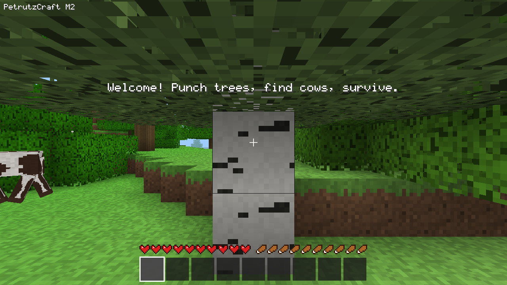
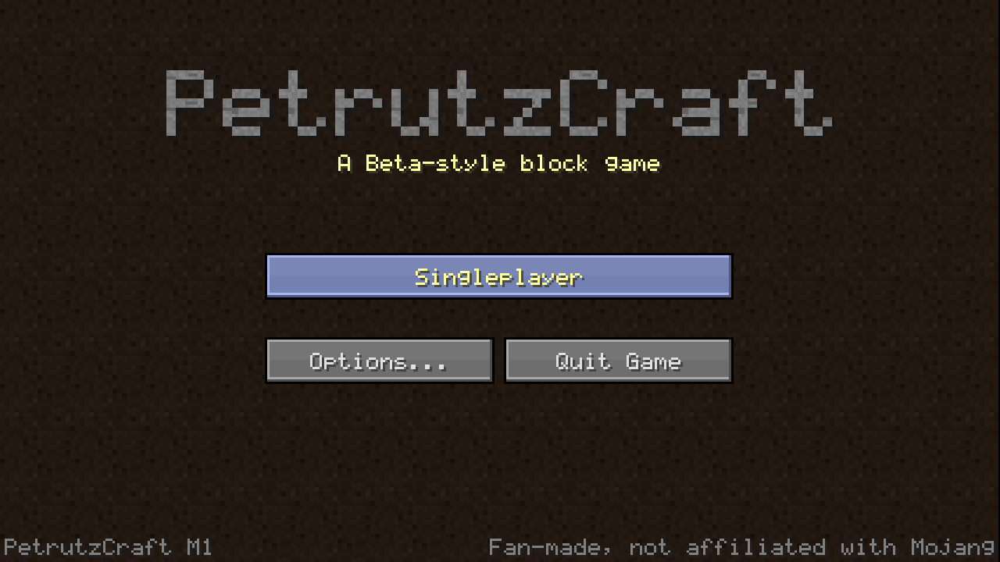
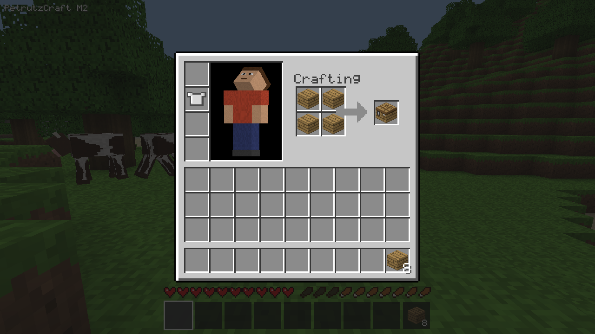
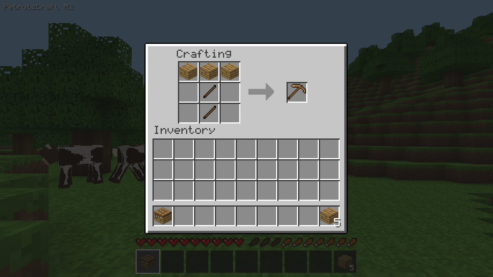
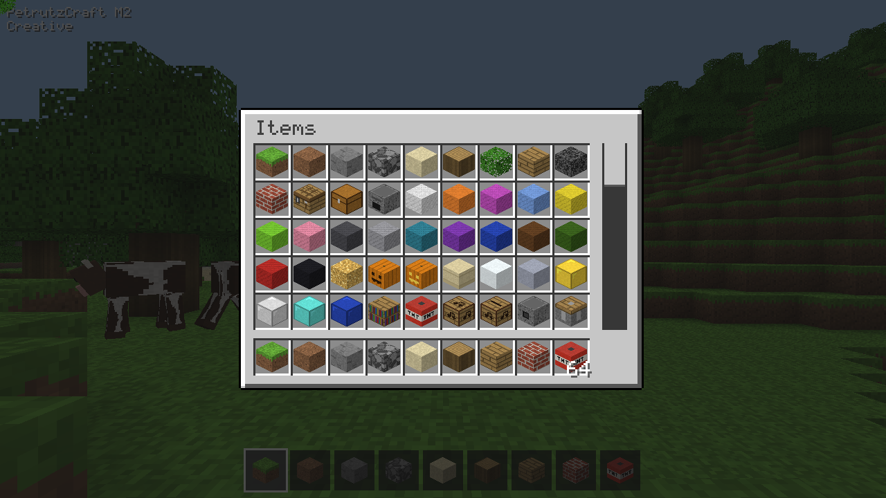
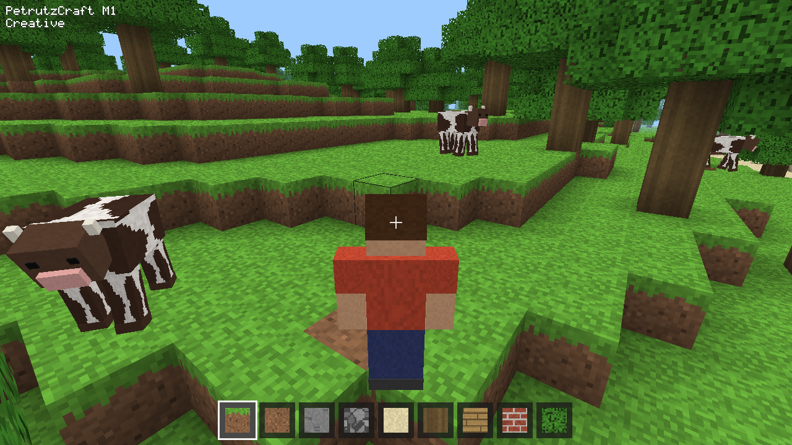
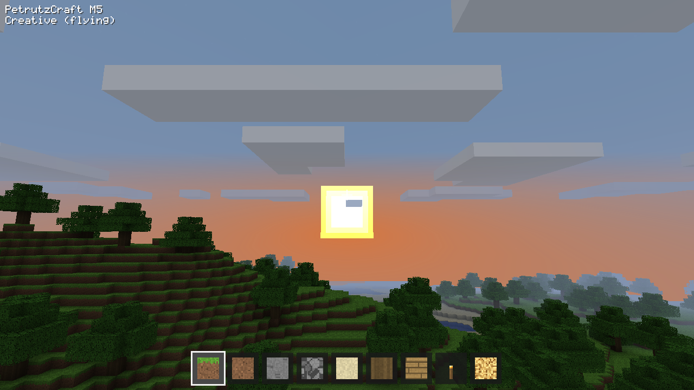
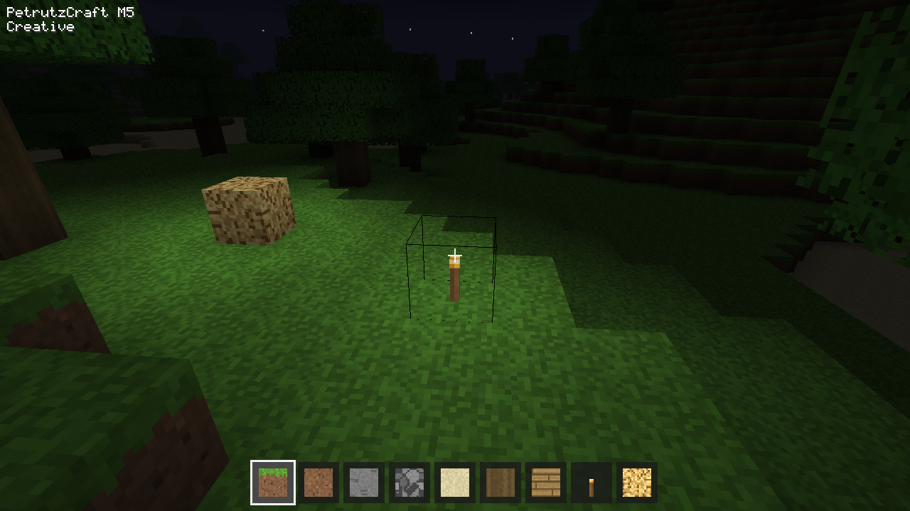

# PetrutzCraft

A small Minecraft-style survival game for the desktop, written in C++20 with OpenGL 3.3.
It runs on Windows (the main target) and Linux.





## Features

- **Title screen and worlds**: Beta-style gray buttons on a dark dirt background, all drawn by the code. Singleplayer lists your worlds (newest first) and lets you create, rename and delete them. A new world takes a name and an optional seed: a number is used as is, any other text is turned into a number, and a blank seed picks a random one.
- **Saving**: worlds are saved every 60 seconds, when you open the pause menu and when you quit. Blocks you changed, where you stand, health, hunger, your whole inventory and armor, cows and dropped items all come back when you load the world.
- **Endless terrain** generated from Perlin noise: grassy hills, sandy beaches, lakes, rare stone peaks and oak trees. The world is 128 blocks tall with the sea at height 64. Chunks are generated (or loaded from the save) and meshed on background threads as you walk, so the game doesn't stutter.
- **Building**: hold the left mouse button to mine a block. The block drops as an item that you pick up by walking over it. Right click places the selected block.
- **Health and hunger**: you have 10 hearts and 10 drumsticks. Walking, sprinting, jumping, mining and fighting use up hunger. When you are well fed you slowly heal. When you are starving you slowly lose health, down to half a heart. Falls of more than 3 blocks hurt, and a big enough fall kills you.
- **Cows** wander, graze and hop up ledges. Punch one and it panics and runs away. Each cow drops 1 to 3 beef, which you eat with a right click to restore 6 hunger.
- Apples sometimes drop from leaves.
- **Inventory and crafting** like Beta 1.7.3: press E for 27 storage slots, the 9-slot hotbar, 4 armor slots and a 2x2 crafting grid, with your character turning to look at the mouse. Place a **crafting table** and right-click it for the 3x3 grid. Every Beta recipe is there (tools, weapons, armor, doors, stairs, slabs, fences, ladders, signs, beds, boats, rails, dyes, wool and the rest), as a table in the code. Shaped recipes work anywhere in the grid and mirrored.

  
  
- **Stacks**: most items stack to 64; snowballs, eggs, signs and empty buckets to 16; tools, armor, cake and mushroom stew don't stack. Food stacks to 64 because hunger is kept. Tools and armor have Beta's durability (shown as a bar once they are worn; they start wearing out in M3).
- Every Beta item exists with an icon drawn by the code (blocks show as little 3D cubes). Items whose use comes in a later milestone (tools mining faster, torches, doors, wool...) can be crafted and carried but not used or placed yet. The crafting table, chest and furnace can be placed; chests and furnaces open in later milestones.
- **Creative mode** (a cheat key) gives you unlimited blocks, instant mining and flying. E opens an item picker with every item: click one to hold a full stack, Shift-click to put it straight in the hotbar, scroll with the mouse wheel.

  
- **Sneaking** (Shift) makes you slower and stops you from walking off edges. **Sprinting**: double-tap W and keep holding it.
- **Third-person view** (F5) shows your character: an original blocky figure with a red shirt and jeans.

  
- **Light**: every block has a sky light and a block light level from 0 to 15, like Beta. Sky light pours straight down from the open sky and spreads sideways one level less per block, so caves, overhangs and the ground under a roof get darker. Leaves dim it by 1 and water by 3 per block. Light is worked out again around every block you place or break.
- **Torches and glowstone** give off light (14 and 15). Torches stand on top of a block or hang on its side, and fall off when that block is broken. Craft 4 torches from coal or charcoal above a stick, or take torches and glowstone from the creative item picker.
- **Day and night**: a day lasts 20 minutes and a new world starts in the morning. The sun rises in the east and sets in the west with an orange glow, then the moon and stars come out. The sky and fog darken and the world gets dark at night (sky light drops by 11 levels), so torches matter.

  

  
- **Clouds** drift slowly over the world at height 108: 3D boxes with Fancy graphics, a flat layer with Fast graphics. They can be turned off in Video Settings.
- **Debug screen** (F3) with your position, chunk, facing, light level (sky and block), time of day, seed and frame rate. F1 hides the HUD and F2 saves a screenshot.
- All textures and the font are drawn by the code itself (no image files), with smooth lighting (ambient occlusion plus light levels blended across each face) and distance fog.

## Build and run on Windows

You need a graphics card with OpenGL 3.3, which almost every computer from the last ten years has.

1. Install **Visual Studio 2022 Build Tools** from <https://visualstudio.microsoft.com/downloads/> (under "Tools for Visual Studio"). In the installer, tick the **Desktop development with C++** workload. It includes the compiler, the Windows SDK and CMake.
2. Install **VS Code** and, from its Extensions panel, the **C/C++** and **CMake Tools** extensions (both by Microsoft).
3. Open this folder in VS Code (File > Open Folder).
4. When CMake Tools asks for a kit, pick **Visual Studio Build Tools 2022 Release - amd64**. (Later you can change it with the command palette: *CMake: Select a Kit*.)
5. In the status bar, set the build variant to **Release**, then click **Build** (or press F7). The first build downloads GLFW, GLM and doctest, which takes a minute.
6. Click the ▷ button in the status bar (or *CMake: Run Without Debugging*, Shift+F5) to play. The program is `build/PetrutzCraft.exe` (or `build/Release/PetrutzCraft.exe`, depending on the generator).

From a terminal instead, open **Developer PowerShell for VS 2022** in this folder and run:

```powershell
cmake -S . -B build
cmake --build build --config Release
.\build\Release\PetrutzCraft.exe
```

Every push also builds `PetrutzCraft.exe` on GitHub: open the latest run under the **Actions** tab and download the **PetrutzCraft-windows-x64** artifact.

## Build and run on Linux

```bash
sudo apt install build-essential cmake ninja-build libxrandr-dev libxinerama-dev libxcursor-dev libxi-dev libgl-dev
cmake -S . -B build -G Ninja -DCMAKE_BUILD_TYPE=Release
cmake --build build
./build/PetrutzCraft
```

## Where your worlds and settings are kept

Everything lives in the folder the program is in (for example `build\Release\`):

| Path | What it is |
| --- | --- |
| `saves/<world>/level.json` | The world's name, seed, play time, spawn point and the player (position, health, hunger, inventory slots 0-35 and armor slots 100-103 like Beta) |
| `saves/<world>/region/r.X.Z.pcr` | The world's chunks, 32 x 32 chunks per file, each one compressed. Cows and dropped items are stored with the chunk they are in |
| `options.txt` | Your settings, one `name:value` per line like Beta's |
| `screenshots/` | Pictures taken with F2 |

Deleting the `build` folder deletes these too, so copy `saves/` somewhere safe first.

## Options

The **Options** button on the title screen (or in the pause menu) has:

- **Invert Mouse** and mouse **Sensitivity**. Music, Sound and Difficulty will be added along with sound and monsters.
- **Video Settings**: **Graphics** Fancy (see-through leaves, 3D clouds) or Fast (solid leaves, flat clouds), **Render Distance** Far (16 chunks), Normal (8, the default), Short (4) or Tiny (2), **Smooth Lighting** on or off, and **Clouds** on or off.
- **Controls**: click a key, then press the new key for it. A key used twice turns red.

Command line:

```bash
PetrutzCraft --seed 42      # fills in the seed when you create a new world
PetrutzCraft --fullscreen
```

## Controls

These are the defaults. Every key except the F keys, Esc, H, R and 1–9 can be changed under Options > Controls.

| Key | Action |
| --- | --- |
| Mouse | Look around |
| W A S D | Move |
| Space | Jump, or swim up in water |
| Left Shift | Sneak: walk slowly without falling off edges |
| Double-tap W (and hold) | Sprint (not possible when hunger is 3 drumsticks or less; stops when you let go, sneak or hit a wall) |
| Left mouse (hold) | Mine a block, or hit a cow |
| Right mouse | Place the selected block (a torch goes on the top or side of the block you point at), or eat the selected food |
| 1–9 / mouse wheel | Choose a hotbar slot |
| Q | Drop one of the selected item |
| E | Open or close the inventory (the item picker in creative) |
| Right mouse on a crafting table | Open the 3x3 crafting grid |
| C | Cheat: switch between survival and creative |
| Space twice (creative) | Toggle flying. While flying, Space goes up and Shift goes down |
| F1 | Hide or show the HUD |
| F2 | Save a screenshot to `screenshots/` |
| F3 | Debug screen |
| F5 | Third-person view |
| H | Show or hide the help text |
| Esc | Pause menu (Back to Game, Options, Save and Quit to Title). The world is saved when it opens |
| R | Respawn after dying |

In the inventory and crafting table screens (Beta's mouse rules):

| Mouse / key | Action |
| --- | --- |
| Left click | Pick up a whole stack, put the held stack down, add it to the same item, or swap with a different item |
| Right click | Pick up half a stack, or put down one item from the held stack |
| Shift + left click | Move a stack between the hotbar and the storage rows, or out of the crafting grid. On the crafted item: craft as many as fit |
| Click outside the window | Throw the held stack (right click throws one) |
| Q over a slot | Throw one item from it |
| E or Esc | Close. Items left in the crafting grid or on the mouse go back into your inventory (and drop only if it's full) |

## Survival tips

- Click **Singleplayer**, then **Create New World**.
- Punch a tree (about 1.5 s per log), press **E** and put the logs in the crafting grid to make planks, then make a crafting table from 4 planks and build a shelter.
- Cows are found on grass. Five spawn near you at the start, and more appear as you explore.
- Keep at least 9 drumsticks of hunger to regenerate health.

## Tests

```bash
ctest --test-dir build --output-on-failure        # logic tests (add -C Release on Windows)
xvfb-run -a -s "-screen 0 1280x720x24" ./build/PetrutzCraft --seed 7 --autotest OUT_DIR
```

The second command plays a scripted game and saves screenshots plus `report.txt` to `OUT_DIR`: it opens the title and options screens, creates a world from the Create New World screen, finds a cow, kills it, picks up and eats the beef, mines and places a block, crafts planks and a crafting table in the inventory screen, puts on a chestplate, crafts a pickaxe on a placed crafting table, takes a stack from the creative item picker, falls, flies, takes F5 and F3 pictures, places a torch and glowstone and checks their light, takes pictures at night and at sunset, opens the pause menu, changes a block, saves and quits to the title, and loads the world again to check that everything came back. Its world and `options.txt` go in `OUT_DIR`, so your own saves are never touched. It exits with an error if any check fails. On Windows or a Linux desktop, run it without `xvfb-run`. GitHub runs both on every push (the screenshot test on Linux only, since GitHub's Windows machines have no graphics card).

## Project layout

```
CMakeLists.txt     build script; downloads GLFW, GLM and doctest
src/
  main.cpp         command-line options and the window
  app.cpp          the title screen, menus and options around the game, loading and quitting worlds
  menu.cpp         every menu screen (title, world list, create/rename/delete, options, controls, pause)
  ui.cpp           2D drawing: rectangles, icons and pixel text for the HUD and menus
  game.cpp         controls, mining/building, survival rules, cows, item drops and saving one world
  save.cpp         save files: level.json, region files, world folders, background saving
  options.cpp      options.txt and the key bindings
  json.cpp         a small JSON reader and writer
  zlib.cpp         zlib compression and decompression (for saves and PNG screenshots)
  world.cpp        chunk storage, terrain generation, meshing (with ambient occlusion and light), ray casting
  light.cpp        sky light and block light: lighting new chunks and updating light after block changes
  sky.cpp          time of day: sun position, sky, fog and cloud colours, how dark the night is, the cloud map
  streamer.cpp     background threads that generate and mesh chunks
  renderer.cpp     OpenGL shaders and drawing the sky, sun, moon, stars, clouds, chunks, cows, items and the block outline
  hud.cpp          crosshair, hotbar, hearts, hunger, text and overlays
  physics.cpp      box-vs-voxel collision used by the player, cows and items
  survival.cpp     the inventory, health, hunger and saturation
  items.cpp        every item: names, stack sizes, durability, food, armor slots, icons
  icons.cpp        pixel art for item icons and the faces of item blocks
  crafting.cpp     the recipe table and matching a crafting grid
  container.cpp    moving stacks in the inventory screens: click, split, shift-click, crafting
  inventory_screen.cpp  drawing the inventory, crafting table and creative picker screens
  mobs.cpp         cow AI and model, the player model, dropped items
  textures.cpp     procedurally generated pixel-art textures
  font.cpp         the 5x7 pixel font
  blocks.cpp       block definitions
  noise.cpp        Perlin noise
  png.cpp          PNG writer for autotest screenshots
  gl.cpp           loads the OpenGL functions the game uses
  autotest.cpp     the scripted smoke test
tests/             doctest logic tests (no window needed)
```

## Known limits

- There are no furnaces, caves or hostile mobs yet.
- No sound, music, weather or monsters yet, and no options for them until they arrive. Rain, snow, thunderstorms and beds come in a second M5 update, after biomes (M4).
- Tools, armor, doors, beds and most other crafted things don't do anything yet; they arrive with M3, M5, M11 and the other milestones. Chests and furnaces are plain blocks for now.
- Ingredients like iron, coal, string and dyes can't be found in survival yet (ores come in M4, mobs in M10); the creative item picker has them.
- Glowstone drops itself when broken (Beta drops glowstone dust, which comes with the Nether in M14). Lava, fire, furnaces and jack-o'-lanterns will give off light once they exist.
- Light levels are not stored in the save files: they are worked out again when a chunk is loaded.
- The menus and text use only plain ASCII letters, numbers and symbols.
- Worlds saved by this version can't be read by the Python version (or by Minecraft).
- The same seed makes a different world than the Python version did, because the random numbers come from a different generator. The terrain rules are the same.
